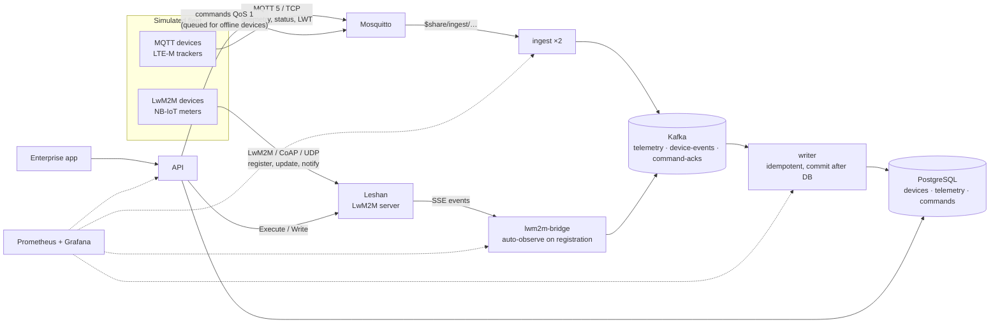

# iot-device-platform

An IoT device-management and telemetry platform you can run on a laptop: simulated NB-IoT /
LTE-M device fleets speaking **LwM2M over CoAP/UDP** and **MQTT 5**, an LwM2M server
([Eclipse Leshan](https://eclipse.dev/leshan/)) and an MQTT broker, **Kafka** in the middle,
**PostgreSQL** for the device registry and telemetry, a northbound **API** for enterprise
applications, and **Prometheus/Grafana** with alert rules. Kubernetes manifests show how it maps
onto EKS (NLBs for UDP/TCP device traffic, MSK, RDS).

It's a personal project that rebuilds, in the open, the kind of platform I deployed and integrated
for telecom operators (device management for large NB-IoT/LTE-M fleets with enterprise
integrations). It isn't code from a former employer or a vendor product.

## Architecture



| Piece | What it demonstrates |
|---|---|
| [`services/simulator`](services/simulator) | LwM2M 1.1 client (register with lifetime, updates, Read/Write/Execute/Observe on `/1`, `/3`, `/4`, `/3303`, SenML JSON and TLV) and MQTT 5 devices (persistent sessions, last will, retained status, QoS 1, commands with acks), reconnects with exponential backoff and full jitter |
| [`services/ingest`](services/ingest) | MQTT → Kafka with a **shared subscription** across replicas; device identity taken from the topic, never the payload; pipelined, batched acknowledgements |
| [`services/lwm2m-bridge`](services/lwm2m-bridge) | Consumes Leshan's event stream; on every registration reads the Device object and starts observations; turns notifications into telemetry |
| [`services/writer`](services/writer) | Kafka → PostgreSQL in batches, offsets committed **after** the transaction, idempotent inserts/upserts, per-partition consumer lag metric |
| [`services/api`](services/api) | Registry, telemetry, fleet stats, commands routed per protocol: MQTT (broker queues for offline devices) or LwM2M (Execute `/3/0/4`, Write `/3/0/14` via Leshan) |
| [`infra/`](infra) | Broker, database, Prometheus (5 alert rules incl. reconnect storms and fleet connectivity drop), Grafana dashboard generated from code |
| [`k8s/`](k8s) | Kustomize manifests: Leshan behind an NLB with **UDP** listeners and source-IP stickiness, broker behind a TCP NLB, HPA for ingest, managed Kafka/PostgreSQL via config and secrets |
| [`docs/`](docs) | [Protocols as implemented](docs/protocols.md), [scaling to 1M devices](docs/scaling.md), [design decisions](docs/decisions.md) |

## Run it

Needs Docker with Compose (on Windows: inside WSL2).

```bash
docker compose up -d --build              # 200 MQTT + 20 LwM2M devices by default
curl localhost:8096/stats                 # fleet overview
open http://localhost:8096/docs           # API (Swagger UI)
open http://localhost:3001                # Grafana: "IoT fleet" dashboard
open http://localhost:8097                # Leshan web UI: registered LwM2M devices
bash scripts/demo-commands.sh             # command scenarios (below)
bash scripts/load-test.sh                 # 2,000 MQTT + 50 LwM2M devices for 4 minutes
bash scripts/reconnect-storm.sh           # broker outage with and without reconnect jitter
docker compose down -v
```

## Measured results (2026-10-13, laptop, Docker in WSL2)

**Command scenarios** (`scripts/demo-commands.sh`, also run in CI): all pass.
1. MQTT command to an online device → delivered and acknowledged (`result: ok`).
2. LwM2M reboot through Leshan (Execute `/3/0/4`) → delivered; the device re-registered.
3. Offline queueing: fleet stopped → device `offline`; command sent → not acknowledged; fleet
   started → the broker delivered the queued command from the persistent session → `ok`.
4. Crash: fleet killed with SIGKILL → the broker published each device's last will (`offline`).

**Load** (`scripts/load-test.sh`: 2,000 MQTT + 50 LwM2M devices, one reading every 5 s):

| Metric | Result |
|---|---|
| Devices connected | 2,000 MQTT + 50 LwM2M |
| Ingested into Kafka (MQTT telemetry) | 350 msg/s, split evenly across 2 replicas (173 / 177 msg/s) |
| Rows written to PostgreSQL | 384 rows/s (MQTT + LwM2M) |
| Writer lag | ≤ 80 messages over the run |

The first run of this test found three problems, all fixed: the simulator and broker hit the
default 1,024 open-file limit and only ~1,015 devices could connect (`ulimits` raised);
`ingest` awaited every Kafka acknowledgement in turn, capping each replica at ~50 msg/s (now
pipelined with batched acks), so the broker's per-client queue overflowed; and Prometheus scraped
a random ingest replica through one service name (now DNS discovery of every replica).

**Reconnect storm** (`scripts/reconnect-storm.sh`: 500 MQTT devices, broker down for 20 s):

| | Without jitter | With full jitter |
|---|---|---|
| Seconds in which ≥25% of the fleet retried at once | 9 | 3 |
| Connection attempts during the test | 2,500 | 2,166 |
| Peak attempts in one second | 500 | 506 |
| Seconds after the broker returned until all reconnected | 13 | 15 |

Jitter turned repeated synchronized waves into one and cut attempts by 13%. The single-second
peak didn't drop because the first retry window is 0–1 s (every device's first retry still lands
in the same second), and recovery was slightly slower: the trade-off jitter makes. Real fleets add
a wider first-retry window and connection-rate limits at the broker (see
[docs/scaling.md](docs/scaling.md)).

## Status
| Part | Status |
|---|---|
| Full stack in Docker Compose | Runs; the results above |
| Unit tests | Simulator (TLV, SenML, backoff, links), ingest routing, bridge event parsing |
| CI | Unit tests, Compose/Prometheus/dashboard/Kubernetes validation, and the full stack + command scenarios in the runner |
| Kubernetes manifests | Rendered and schema-validated; **not yet deployed to a cluster** |
| Device identity at the broker | Every MQTT client authenticates (devices with a per-device secret, services as their own users) and a device may only use its own topics; `scripts/acl-test.sh` in CI: anonymous and wrong-password clients refused, a reading published on another device's topic never reaches PostgreSQL, another device's commands never delivered to it (Mosquitto grants the subscription and enforces read at delivery) |
| Not modelled | DTLS, LwM2M bootstrap and firmware update, real sleep in queue mode, broker TLS (listed in [docs/protocols.md](docs/protocols.md)) |
