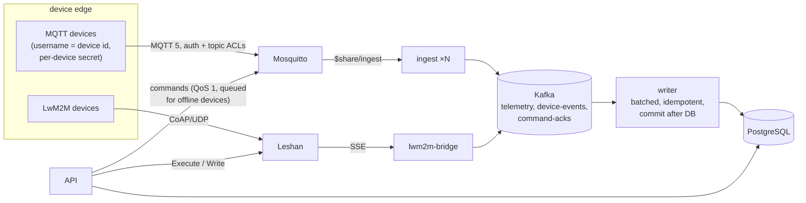

# iot-device-platform: architecture

Protocol behaviour is in [`protocols.md`](protocols.md), choices in [`decisions.md`](decisions.md), and the path to a million devices in [`scaling.md`](scaling.md). This page is the system view.

## 1. Context

An operator runs connectivity for enterprises with large fleets of constrained devices: NB-IoT meters that wake a few times a day, LTE-M trackers that report every few seconds. The platform must:
- talk the devices' protocols (LwM2M over CoAP/UDP, MQTT over TCP);
- take bursts when thousands reconnect at once;
- never lose or double-count a reading;
- deliver commands to devices that are asleep;
- be certain which device sent what.

## 2. Guarantees, and what provides each

| Guarantee | Mechanism |
|---|---|
| A reading is never lost between broker and database | MQTT QoS 1 to the broker; Kafka `acks=all` with an idempotent producer; the writer commits Kafka offsets only **after** the database transaction |
| A reading is never stored twice | At-least-once everywhere, made exact at the end: primary key `(device_id, ts)` with `ON CONFLICT DO NOTHING` |
| A command reaches a device that was offline | Persistent MQTT sessions (`clean_start=False` plus session expiry): the broker queues QoS 1 commands; Leshan queue mode for LwM2M |
| Offline is detected without polling | MQTT Last Will: the broker publishes `offline` (retained) when a connection dies uncleanly; LwM2M registration lifetimes |
| **The sender is who the data says it is** | Ingest takes the device id from the topic, never the payload. The broker authenticates every client and enforces topic ACLs, so only device *X* can publish on `devices/X/...` |
| A broker outage doesn't become a storm | Exponential backoff with full jitter on reconnect (measured: 9 synchronised waves without jitter, 3 with); Kafka absorbs the burst after recovery |

## 3. Device identity and authorisation

- **Authentication:** every MQTT client logs in. Devices use their device id as username and a per-device secret. In the lab, the secret is `HMAC-SHA256(fleet secret, device id)`, provisioned into the broker image at build time, like a factory-flashed secret. The ingest and API services have their own users. Anonymous clients are refused.
- **Authorisation (`infra/mosquitto/acl`):**
  - a device may write only `devices/<its id>/telemetry`, `/status` and `/commands/ack`, and read only `devices/<its id>/commands`;
  - ingest may read every device topic (directly and through its shared subscription) and write nothing;
  - the API may write only command topics.
- **Proof (`scripts/acl-test.sh`, CI):**
  - an anonymous client and a wrong password are refused;
  - a reading that device A publishes on device B's topic is dropped at the broker and never reaches PostgreSQL;
  - A's reading on its own topic does arrive (the positive control, so a broken pipeline can't pass as a working ACL);
  - B's commands are never delivered to A, even with A subscribed to B's command topic. Mosquitto grants such a subscription and enforces read permission at delivery, which the test checks.
- **What's left for production:**
  - TLS on 8883 with per-device X.509 certificates, so the identity is the certificate, not a password;
  - the broker binding the client id to that identity. Today a device that knows another's client id could still take over its session: a denial of service, not a data spoof, because the ACL is on the username.

## 4. Data flow and scaling

| Stage | Scales by | Bottleneck observed in the load test |
|---|---|---|
| Broker | Cluster (EMQX/HiveMQ) behind a TCP NLB | One node: file descriptors (the default 1,024 stopped the fleet at about 1,015 devices) |
| Ingest | Replicas on the MQTT shared subscription | Serial Kafka produce capped a replica at about 50 msg/s; pipelining fixed it |
| Kafka | Partitions (keyed by device id, so per-device order holds) | 6 partitions locally; about 64 per hot topic at scale |
| Writer | Consumers up to the partition count; batched inserts | Consumer lag stayed ≤ 80 at 350 msg/s |
| Storage | Time-partitioned telemetry; the registry stays relational | One table won't hold 19 TB/year (see `scaling.md`) |

## 5. Observability

Prometheus scrapes every service. There are five alert rules, including a reconnect storm (the connection-attempt rate) and a drop in fleet connectivity (the fraction of the fleet online). The Grafana dashboard is generated from code, and CI checks it matches its generator.

## 6. Testing

| Level | What |
|---|---|
| Unit | Simulator (TLV, SenML, backoff, links, the device-secret derivation matching the broker), ingest routing, bridge event parsing |
| Config | Compose; Prometheus config and rules (promtool); the dashboard against its generator; Kubernetes manifests (kustomize + kubeconform) |
| End to end (CI) | The full stack with a small fleet: devices online, telemetry through Kafka into PostgreSQL, command scenarios over both protocols, broker identity and ACLs |
| Load and storm (local) | 2,000 MQTT + 50 LwM2M devices at 350 msg/s; reconnect storm with and without jitter |

## 7. Next steps

- TLS with per-device certificates, and client-id binding.
- Deploy the Kubernetes manifests to a cluster: NLB with UDP for Leshan, HPA or KEDA for ingest.
- Firmware campaigns in cohorts gated on success rate. That's the subject of the separate fleet-operator project.
